<div align="center">

# 💍 Knots

**Plan your wedding, together.**

Budget, guests, gifts and every detail in one calm place. Built for the groom's side and the bride's side to plan side by side.

[](https://knots-sonakash.web.app)


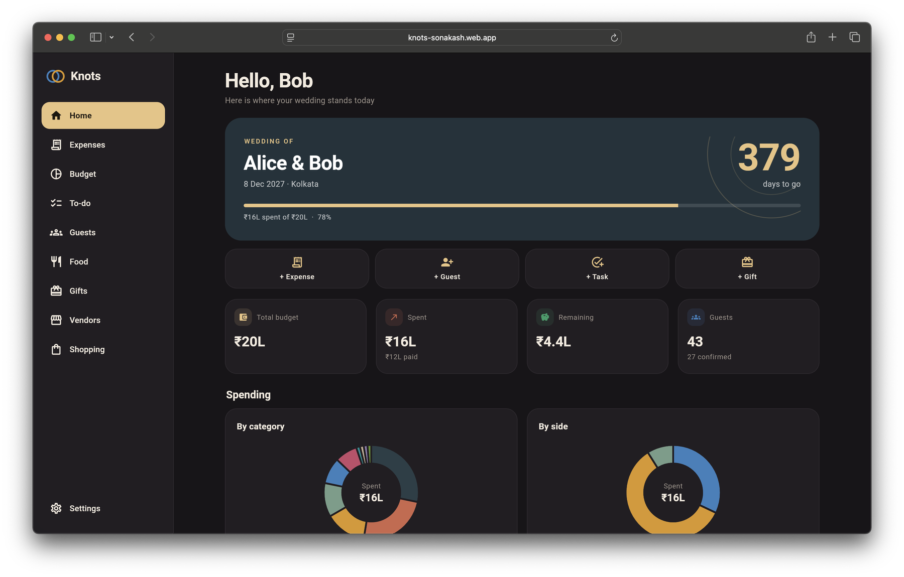

</div>

---

## ✨ Try it now

Open **[knots-sonakash.web.app](https://knots-sonakash.web.app)**, choose **Join a wedding**, and enter:

| Field | Value |
|---|---|
| Your name | anything you like (e.g. `Bob`) |
| Side | Groom or Bride |
| **Wedding code** | **`TESTTEST`** |

> The test wedding is shared and filled with sample data. Anyone with the code can edit it, so please be kind. 🙂

No sign-up, no password. The 8-letter wedding code is the only key.

---

## 🌟 Features

### 🏠 Dashboard: the whole wedding at a glance
A live countdown, overall budget progress, quick-add buttons and stat tiles for budget, spending, what's left and guests. Below that:

- **Spending by category** and **by side** (donut charts)
- **Spending over time**: a cumulative line chart
- **Groom vs Bride**: side-by-side bars for money spent, guests invited, gifts received and tasks done
- **RSVP status**, **guests by side** and **gifts by side**
- **Budget check**: every category's spend against its plan
- **Coming up**: the next tasks due

<p align="center">
  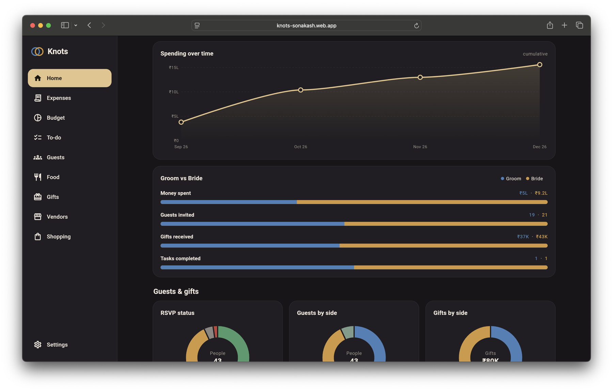
  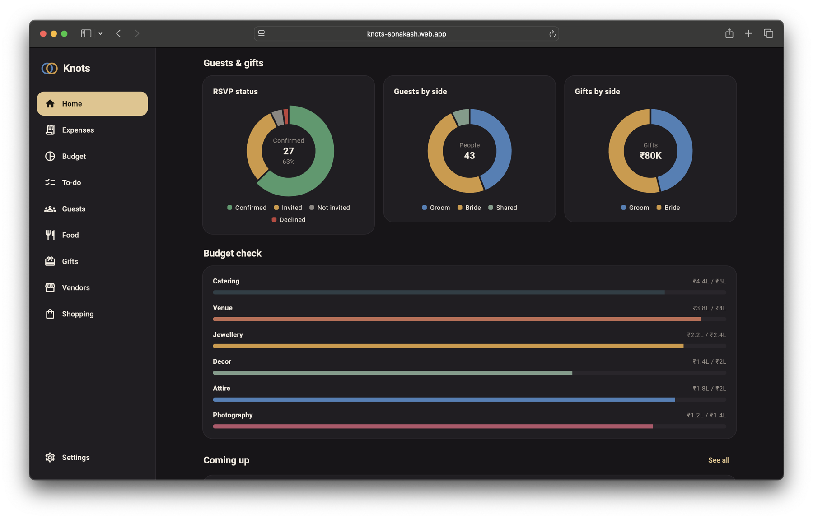
</p>

### 🧾 Expenses
Every rupee, tagged to a side. Record the total, the amount paid so far, the category, payment mode and date. Totals for **paid** and **balance due** update as you go. Search, and filter by side (Groom / Bride / Shared) and status (Paid / Partial / Pending).

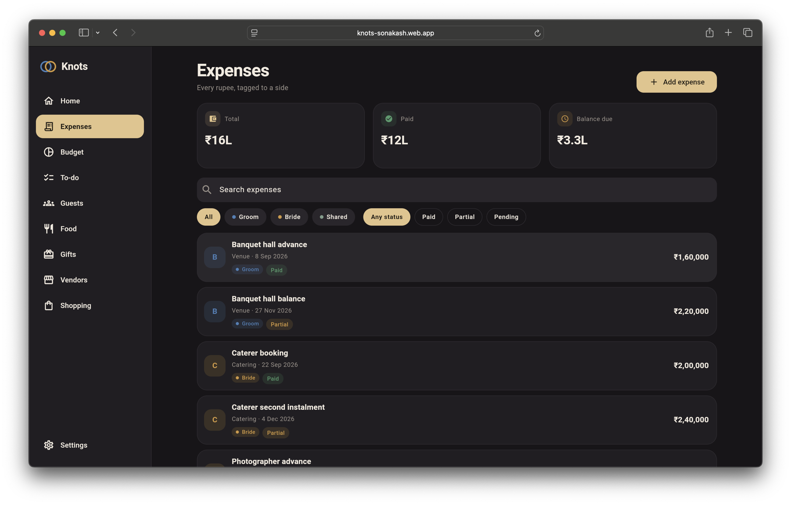

### 📊 Budget
Planned vs actual for each category (venue, catering, decor, photography…), with an overall progress bar showing how much is left and what percentage is used.

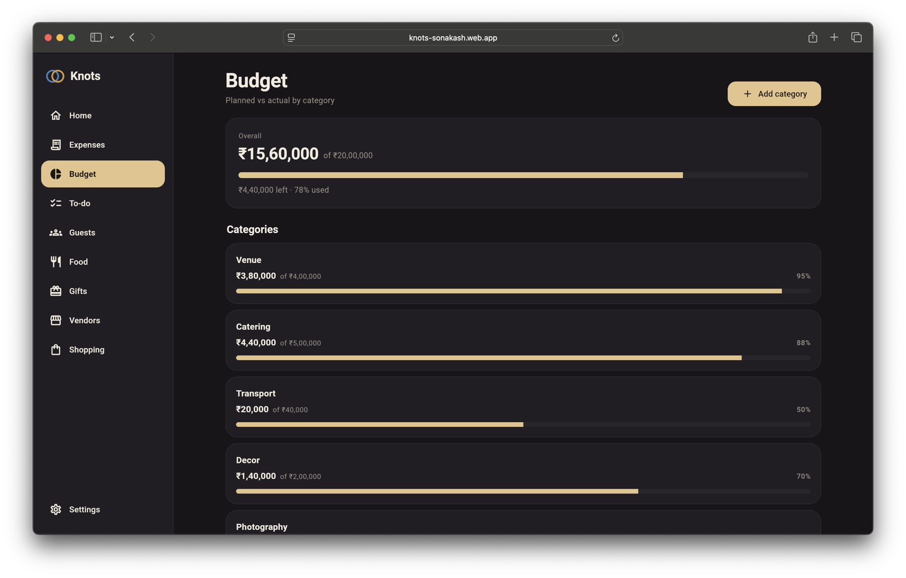

### ✅ To-do
What needs doing, and by whom. Tasks have a responsible side, due date, priority and status (To do / In progress / Done). Overdue items are flagged automatically.

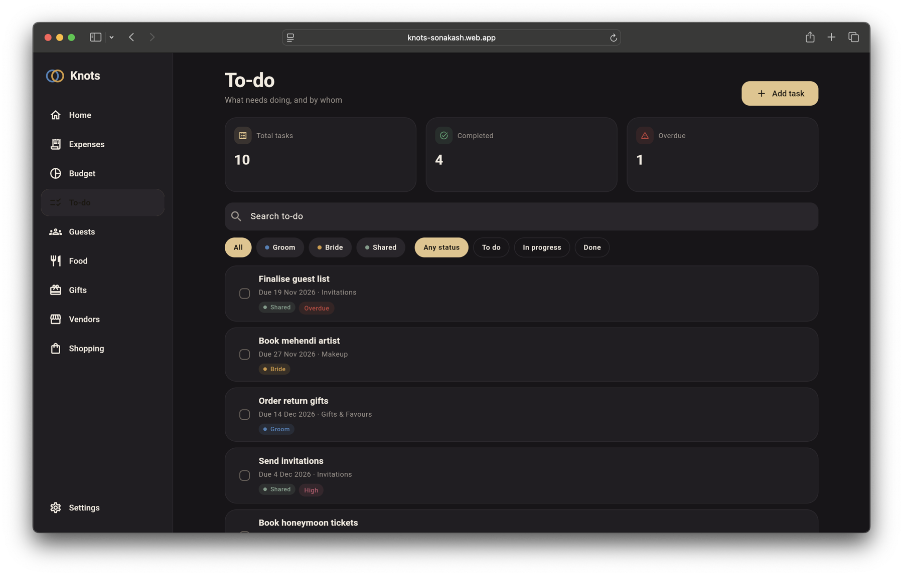

### 👨‍👩‍👧 Guests & RSVP
Families and friends with headcount, city, relation, events invited to and whether they need accommodation. Track invitations through **Not invited → Invited → Confirmed / Declined** and see the headcount, confirmed count and how many haven't replied yet.

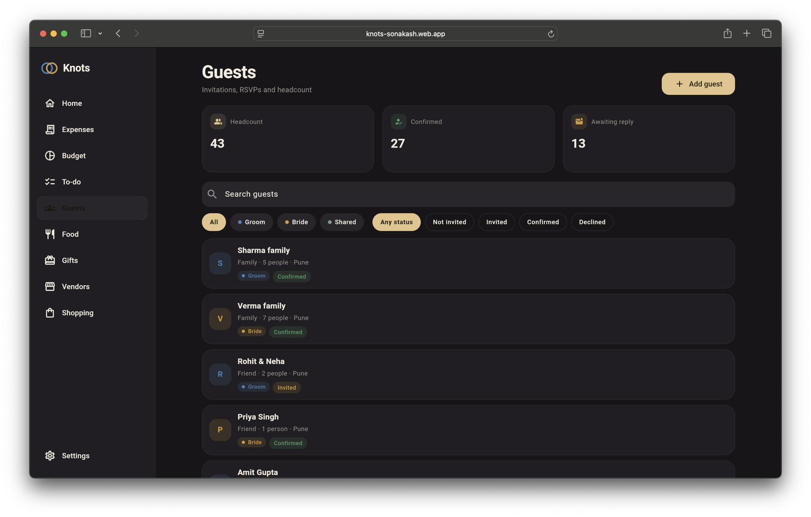

### 🍽️ Food & menu
Build the menu dish by dish with course, veg/non-veg, event and per-plate cost. Mark dishes as approved, and Knots multiplies the **approved cost per plate × confirmed guests** to give you a catering estimate.

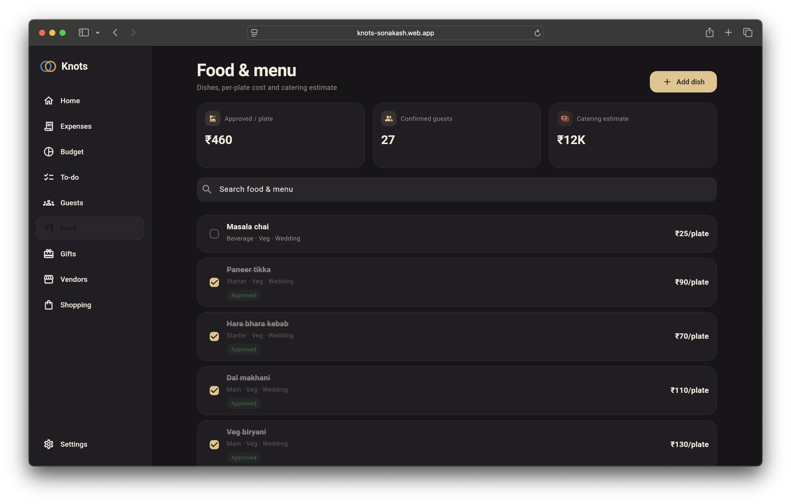

### 🎁 Gifts
Who gave what, and who still needs a thank-you. Log cash, gold, items or vouchers by giver, side, occasion and value, and tick them off once thanked.

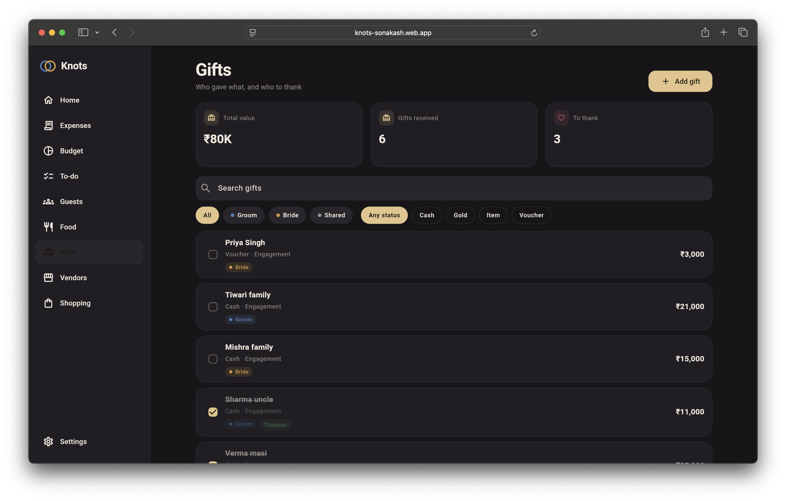

### 🏪 Vendors
Caterers, photographers, decorators, DJs… Track each quote, the advance paid and the balance, and move vendors from **Shortlisted → Booked → Paid**.

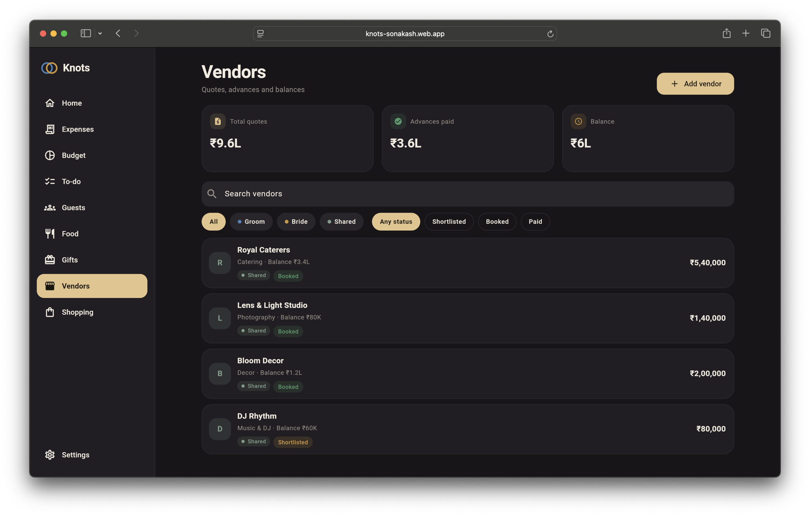

### 🛍️ Shopping
Things to buy with estimated and actual prices. Tick items off as they're bought and keep an eye on estimated vs spent.

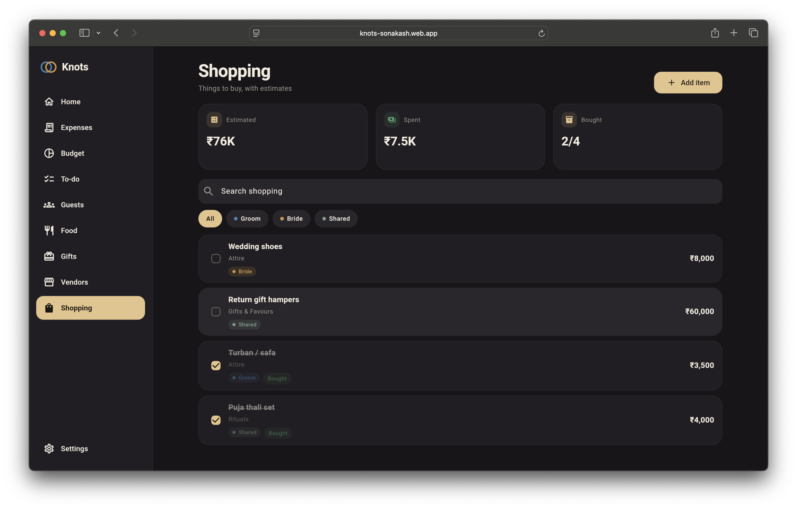

### ⚙️ And also
- **Two sides, one wedding**: every record stores its side (groom / bride / shared) and who added it
- **Real-time sync**: changes show up instantly on every device
- **Works offline**: Firestore cache keeps the app usable without signal
- **Installable PWA**: add it to your home screen on phone or desktop
- **Light, dark or auto** theme
- **CSV export** of every section from Settings
- **Undo** after deleting a record
- **Responsive**: sidebar on desktop, bottom navigation on mobile

---

## 🔐 How sharing works

There's no sign-up. Creating a wedding generates an **8-letter code** made from the first four letters of each name (e.g. Alice + Bob → `ALICBOBX`; names shorter than four letters are padded with random letters). If that code is taken, a number replaces the last letters. Your partner and family join with that code from the welcome screen, and you can find it again any time in **Settings**.

Firestore security rules block listing weddings, so the code acts as the shared secret. Weddings can only be opened by exact code, and only the known sections can be read or written. (Firebase Auth isn't used because enabling it needs a billing account, and Knots runs on the free Spark plan.)

---

## 🛠️ Tech stack

| | |
|---|---|
| UI | [Flutter](https://flutter.dev) (web), Material 3 |
| State | [Riverpod](https://riverpod.dev) |
| Routing | [go_router](https://pub.dev/packages/go_router) |
| Charts | [fl_chart](https://pub.dev/packages/fl_chart) (loaded lazily) |
| Data | Cloud Firestore with offline persistence |
| Hosting | Firebase Hosting |

```
lib/
├── main.dart            # Firebase init, router, lazy dashboard
├── core/                # theme, shared UI widgets, formatting, CSV
├── data/store.dart      # session, Firestore providers, Repo (create/join/CRUD)
└── features/
    ├── welcome.dart     # create or join a wedding
    ├── dashboard.dart   # charts and summaries
    ├── budget.dart      # planned vs actual
    ├── modules.dart     # field definitions for every section
    ├── module_screen.dart  # generic list / filter / form screen
    ├── settings.dart    # code, theme, export, log out
    └── shell.dart       # sidebar / bottom navigation
```

---

## 🚀 Run it locally

```bash
flutter pub get
flutter run -d chrome
```

## 📦 Deploy

```bash
flutter build web --release
firebase deploy --only hosting      # the site
firebase deploy --only firestore    # security rules + indexes
```

## 🎨 Customise

- **Colours, fonts, radii**: `lib/core/theme.dart`
- **Sections and their fields**: `lib/features/modules.dart`
- **Logo**: `KnotsMark` in `lib/features/welcome.dart`; PWA icons in `web/icons/`
